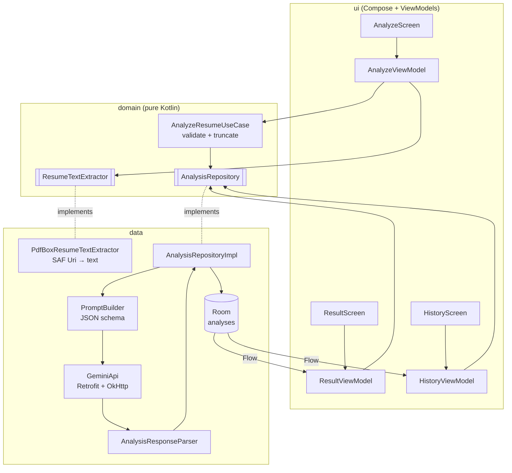

# ResumeLens

**AI resume-to-job matcher for Android.** Pick your resume PDF, paste a job description, and get:

- a **match score** (0–100) on an animated gauge
- **missing skills** the job asks for
- **weak bullet points** with stronger, copy-ready rewrites
- **ATS keywords**, marked as found or missing in your resume

Every analysis is saved on the device so you can revisit it later.

Built with Kotlin, Jetpack Compose (Material 3), MVVM, Hilt, Room, Retrofit and the Gemini API.

---

## Screenshots

| Analyze | Results | Rewrites | History | Dark mode |
|---|---|---|---|---|
|  |  |  |  |  |

> Capture your own with `adb exec-out screencap -p > docs/screenshots/analyze.png`

---

## Architecture

Clean-architecture layering with MVVM in the UI. Dependencies point inward: `ui → domain ← data`.
The domain layer is plain Kotlin with no Android imports, which makes it trivially unit-testable.



### Data flow of one analysis

1. The user picks a PDF with the **Storage Access Framework** (`OpenDocument`), so no storage permission is needed.
2. `PdfBoxResumeTextExtractor` reads the text on `Dispatchers.IO` (injected, so tests can swap it).
3. `AnalyzeResumeUseCase` validates the minimum lengths and truncates long input before spending an API call.
4. `AnalysisRepositoryImpl` sends a request whose `responseSchema` forces Gemini to return JSON in our exact shape.
5. `AnalysisResponseParser` treats that output as untrusted: it clamps the score, removes duplicates and caps list sizes.
   Anything malformed becomes a typed `AppError`, never a crash.
6. The result is **inserted into Room** and the ViewModel emits a one-shot `OpenResult(id)` event.
7. `ResultScreen` observes that row as a `Flow`. Room is the **single source of truth**, so a fresh result and
   one opened from History use exactly the same code path.

### Key decisions

| Decision | Why |
|---|---|
| `AppResult` + sealed `AppError` instead of exceptions | Every failure is a named case the UI maps to a friendly message. The `when` is exhaustive, so a new error type cannot be forgotten. |
| Result stored as a JSON column | It is always read as a whole and never queried by its parts. Score and title have their own columns because the History list sorts and shows them. |
| `Channel` for navigation events | A `StateFlow` would replay "navigate" after rotation. A channel delivers each event once. |
| Stateless `*Content` composables | Screens take state in and send callbacks out, so they can be UI-tested without Hilt or ViewModels. |
| Robolectric for Compose tests | UI tests run on the JVM with `gradlew test`, so no device or emulator is needed (CI-friendly). |
| Dynamic colour disabled | A consistent brand look instead of the wallpaper-derived default. |

---

## Setup

### Prerequisites
- JDK 17+
- Android SDK with platform 37 and build-tools (`sdkmanager "platforms;android-37.0" "build-tools;36.0.0" platform-tools`)
- `ANDROID_HOME` set, and `platform-tools` on `PATH` for `adb`
- A free Gemini API key from <https://aistudio.google.com/apikey>

### Configure
```powershell
copy local.properties.example local.properties
# then edit local.properties: set sdk.dir and GEMINI_API_KEY
```
`local.properties` is git-ignored. The key is injected into `BuildConfig` at build time.

### Build, install and debug (no Android Studio needed)
```powershell
.\gradlew.bat assembleDebug                                    # APK → app\build\outputs\apk\debug\
.\gradlew.bat installDebug                                     # install on the USB-connected phone
adb shell am start -n com.resumelens/.MainActivity             # launch
adb logcat --pid=$(adb shell pidof -s com.resumelens)          # logs from this app only
.\gradlew.bat testDebugUnitTest                                # unit + Compose UI tests
```
In VS Code these are available as tasks (**Terminal → Run Task**): *Build*, *Install*, *Logcat* and *Test*.

---

## Tech stack

| Area | Library |
|---|---|
| Language | Kotlin 2.3, coroutines, Flow |
| UI | Jetpack Compose, Material 3, Navigation Compose (type-safe routes) |
| DI | Hilt (KSP) |
| Persistence | Room (KSP, exported schema) |
| Networking | Retrofit 3, OkHttp 5, kotlinx.serialization |
| PDF | PdfBox-Android |
| AI | Google Gemini (`gemini-flash-lite-latest`) `generateContent` with structured JSON output |
| Testing | JUnit 4, MockK, Turbine, kotlinx-coroutines-test, Robolectric + Compose UI Test |
| Build | AGP 9 (built-in Kotlin), Gradle version catalog, Gradle wrapper |

---

## Known limitations

- **The API key ships inside the APK.** Anyone can decompile the APK and read it. That is fine for a personal
  portfolio build. A production app would call Gemini through a small backend proxy that holds the key and applies rate limits.
- **Privacy:** resume text is sent to Google. On the Gemini free tier, Google may use prompts to improve its
  products. The app says so on the Analyze screen.
- **Scanned PDFs are not supported.** PdfBox only reads embedded text; image-only PDFs show a clear error.
  OCR (e.g. ML Kit Text Recognition) would be a natural next step.
- **Multi-column layouts** can extract in an unusual order, which may slightly affect results.
- **LLM output varies.** Scores can shift by a few points between runs. Temperature is set low (0.2) and the
  prompt includes a scoring rubric to keep results consistent.
- **Model choice:** the default is Gemini Flash-Lite, which answered in about 3 seconds in testing. The full Flash model is a
  "thinking" model that took more than 4 minutes on the free tier, longer than the app's 2-minute timeout. Override it with `GEMINI_MODEL`.
- **Free-tier rate limits** show a "wait a minute" error rather than queuing requests.
- No cloud sync: history lives only on the device (`allowBackup` is off on purpose, because resumes are personal data).
